  

  

  Escreva o que você lembra da foto, do jeito que falaria com alguém. 
  O BuscadorFAST procura em todos os seus discos, pelo que aparece na imagem.

  

 

  
  
  
  
  
  
  

 

  

<h2 align="center">Para quem edita</h2>

  Achou a cena? Mande direto para o projeto aberto no <b>Premiere</b>. 
  As palavras-chave também vão para o <b>Lightroom</b>, gravadas nos arquivos.

 

<h2 align="center">Comece em três passos</h2>

  

<b>O Windows avisou "O Windows protegeu o computador". E agora?</b>

 
O instalador não tem uma assinatura digital paga, então o Windows mostra esse aviso. Clique em <b>Mais informações</b> e depois em <b>Executar assim mesmo</b>.

<b>Meu computador dá conta?</b>

 

| | |
|---|---|
| Sistema | Windows 10 ou 11, 64 bits |
| Memória | 16 GB de RAM (com 8 GB funciona, mais devagar) |
| Espaço | uns 15 GB para o programa e a IA, mais o catálogo |
| Placa de vídeo | uma NVIDIA RTX deixa tudo bem mais rápido. Sem ela, também funciona, só leva mais tempo |
| Internet | só para instalar e na primeira vez que cada recurso de IA é usado |

<b>Como atualizo ou removo?</b>

 
Para atualizar, rode o instalador da versão nova por cima: o catálogo continua. Para remover, use <b>Configurações → Aplicativos</b> do Windows. Suas fotos e vídeos nunca são apagados.

<b>Quanto tempo leva para indexar?</b>

 
Depende de quantos arquivos você tem e da placa de vídeo. Você já pode buscar enquanto ele trabalha, e o que fica pronto aparece na hora. Se parar no meio, ele continua de onde estava.

 

  

  
    <a href="LEIAME.md">Manual completo</a> ·
    <a href="docs/TECNICO.md">Como funciona por dentro</a> ·
    <a href="https://github.com/herbeth98/BuscadorFAST/releases">Todas as versões</a>
  

